# Reading a Whole FT8 Band from My Radio's Speaker, with GNU Radio

*No dongle this time. Just my HF radio, a cable from its speaker to my laptop's sound card, and six small Python blocks in GNU Radio that take turns on every 15-second FT8 window. They pull out every station they can find, peel the loud ones away to hear the quiet ones underneath, and print the whole lot as a table. This is how each stage does its part, and the eight things that went wrong along the way.*

[Code repo here](https://github.com/handiko/FT8-Decoder-GNU-Radio)
---
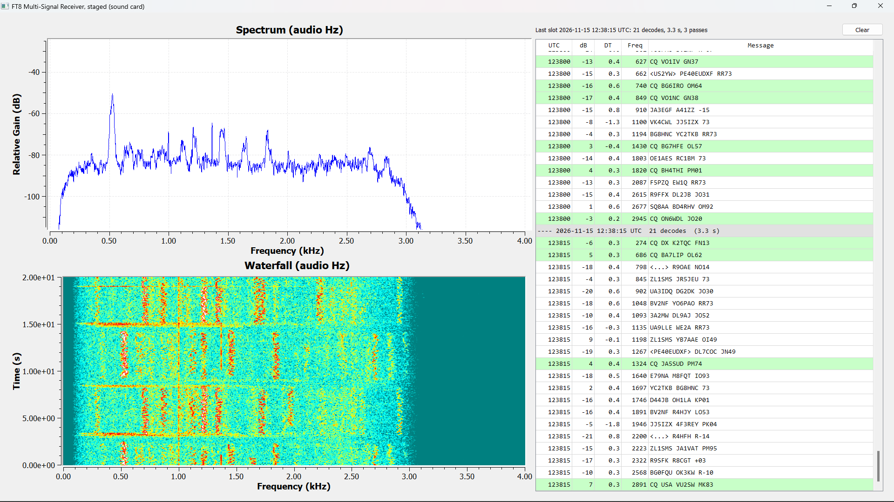

## Why I did this

Tune any HF band to its FT8 frequency and you'll hear a strange chord: a few dozen soft whistles, all starting at once, holding for about thirteen seconds, then silence, then all starting again. Every one of those whistles is a station. Some are calling CQ, some are answering, some are sending a signal report. WSJT-X turns that chord into a neat list every 15 seconds, and I've used it for years without really knowing how.

I wanted to know. And as usual, I wanted to build it myself in GNU Radio on my Windows laptop, so that every step is out in the open and I can look at it. No WSJT-X under the hood, no out-of-tree modules, no DLLs.

I could have put the whole decoder in one big Python block. It would work, but it would be a black box with a nicer border. So I built it as six stages, one job each, connected by messages, so I can see what every stage hands to the next. That's this flowgraph, `ft8_rx.grc`.

- **Part 1** explains what an FT8 signal is.
- **Part 2** covers the front end, and why there's no FFT block in front of the decoder.
- **Parts 3 to 8** follow one slot through the six stages.
- **Part 9** asks what splitting the decoder into stages costs.
- **Part 10** is the war stories.

**One honest note up front.** Everything I measured here comes from 22 real recorded FT8 slots (Results says where they come from), played into the flowgraph instead of my sound card. The next step is my own radio on the air, and I haven't done that yet. The flowgraph is built for it, and the sound-card path is the same three stock blocks every audio flowgraph uses, but I'm not going to claim on-air results I don't have.

As usual, a few DSP words show up (spectrogram, soft bit, LDPC, GFSK…). I explain each one the first time I use it.

---

## What I used

- **An HF radio** in USB mode, with its filter at about 3 kHz.
- **One audio cable** from the radio's speaker (or line out) to the laptop's Line In.
- **Windows laptop** with **radioconda** (GNU Radio 3.10). Stock blocks plus Embedded Python Blocks, and only numpy inside them.
- **Time-sync software** keeping the PC clock on UTC. FT8 doesn't work without it.
- **The ft8_lib test recordings** (22 slots, each with the list of messages WSJT-X decoded from it) for checking my work.

The files:

- **ft8_rx.grc**: the flowgraph. It's self-contained: all six Python stages live inside it, and GRC writes them out when you generate.
- **ft8_rx_explained.md**: the technical write-up.
- **ft8_pe_\*.svg**: the eleven diagrams in this document. Keep them in the same folder.

---

## The rule I followed

Same rule as every one of my GNU Radio projects:

> Put each operation in a stock block if one exists. Use an Embedded Python Block (EPB) only for what GNU Radio cannot do natively.

With FT8 the rule leaves Python a lot more to do than usual. GNU Radio is built for streams: samples flowing in and out, forever. FT8 isn't a stream problem. It's a "collect 15 seconds, then think hard" problem. Stock blocks handle the sound card, the filtering and the displays. Everything after that, from cutting slots to unpacking callsigns, has no stock block that can do it, so it's Python. What I could do was make that Python **visible**: six blocks with one job each, instead of one block that does everything.

Here's the whole receiver on one page:

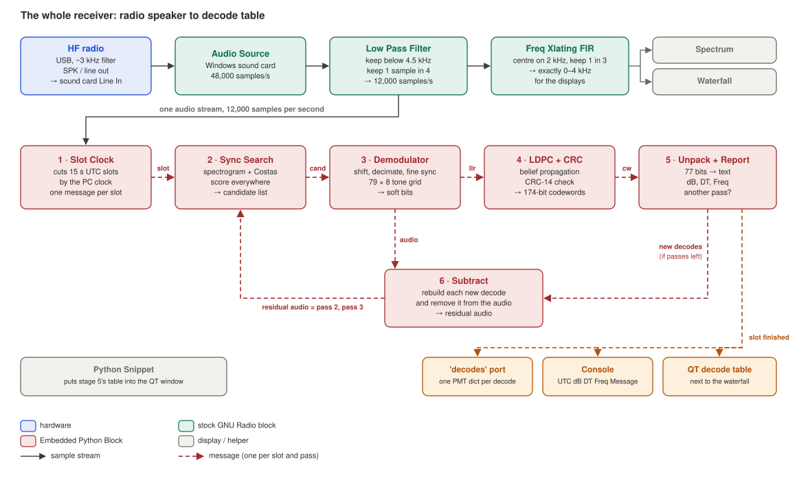

Blue is hardware, green boxes are stock blocks, coral ones are my six Python stages, grey ones are displays and helpers. Solid arrows carry samples. Dashed arrows carry messages: one per slot, and one per pass for stages 2 to 6. Notice the dashed arrow going *backwards* from stage 6 to stage 2. That's the trick that finds the weak stations, and Part 8 is all about it.

---

## Part 1: what an FT8 signal is

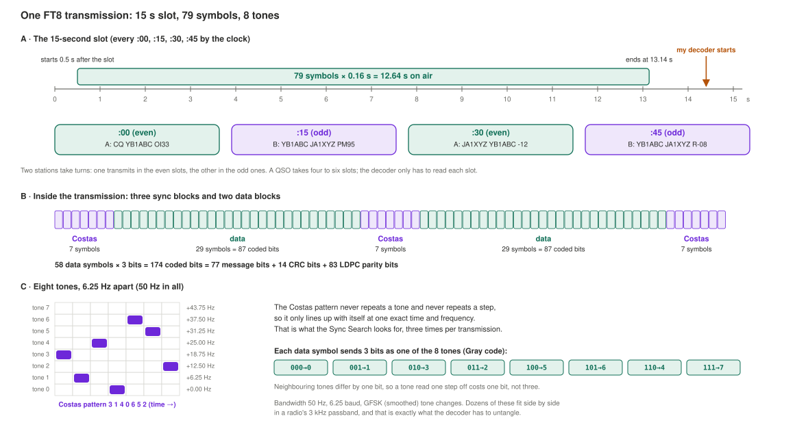

### Fifteen seconds at a time

FT8 runs on the clock. Every minute is cut into four **slots**, starting at :00, :15, :30 and :45. A station starts transmitting half a second into a slot and stops 12.64 seconds later. Two stations in a QSO take turns: one uses the even slots (:00, :30), the other the odd ones (:15, :45). A whole contact (CQ, answer with grid, report, R-report, RR73) takes four to six slots.

That makes my job simpler than it sounds. The decoder never has to follow a conversation. It only has to read **one slot at a time**, as completely as possible.

### 79 symbols, 8 tones

Each transmission is **79 symbols**, 0.16 s each:

- **three sync blocks** of 7 symbols, at the start, in the middle and at the end;
- **two data blocks** of 29 symbols between them.

Each symbol is one of **8 tones**, 6.25 Hz apart, so a whole FT8 signal is just 50 Hz wide. That's why dozens of them fit side by side in a radio's 3 kHz passband. The tone changes are smoothed (**GFSK**, Gaussian frequency-shift keying), so the signal doesn't splatter.

The sync blocks always send the same pattern: tones 3, 1, 4, 0, 6, 5, 2. It's a **Costas array**, a pattern that only lines up with a copy of itself at one exact time and one exact frequency. Shift it by a symbol or a tone and almost nothing matches. That property is what makes it possible to find a 50 Hz signal in a crowded band.

### 174 bits, 77 that matter

Each data symbol carries 3 bits, through a **Gray code**: neighbouring tones differ in only one bit, so reading a tone one step off costs one bit, not three. 58 data symbols × 3 bits = **174 coded bits**:

| Part | Bits | What for |
|---|---|---|
| Message | 77 | The actual content: two callsigns plus a grid or report, or another message type |
| CRC | 14 | A checksum, to catch a wrong decode |
| LDPC parity | 83 | Error-correction bits. They let the receiver repair a lot of wrong bits |

Half the transmission is protection. Part 6 shows how much that protection is worth.

---

## Part 2: the front end, and why there's no FFT block

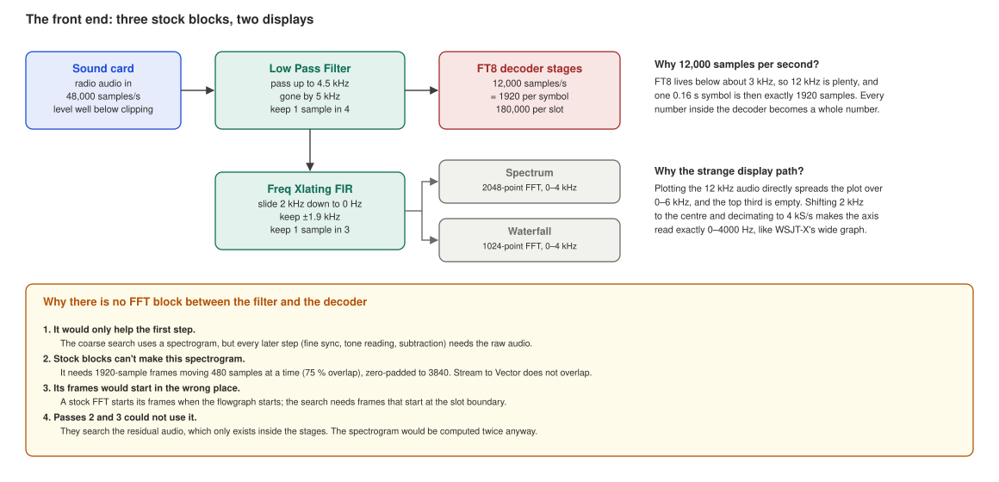

Three stock blocks do all the signal handling:

1. **Audio Source** reads the sound card at 48,000 samples per second.
2. **Low Pass Filter** keeps everything below 4.5 kHz and keeps one sample in four: **12,000 samples per second**. I picked that rate because one 0.16 s symbol is then exactly **1920 samples**. Every number inside the decoder comes out a whole number.
3. **Frequency Xlating FIR**, for the displays only: it slides 2 kHz down to 0 Hz and keeps one sample in three. The spectrum and waterfall then read exactly 0 to 4000 Hz, like WSJT-X's wide graph.

### The FFT block I didn't add

When the flowgraph was almost done, I wondered whether an FFT block between the filter and the decoder would make the flowgraph more transparent. It looked like it should: the first thing the decoder does is a spectrogram.

It doesn't work, for four reasons:

- **It would only help the first step.** Fine sync, tone reading and subtraction all need the raw audio, not a spectrum.
- **Stock blocks can't make this spectrogram.** The search needs 1920-sample frames that move only 480 samples at a time (75 % overlap), zero-padded to 3840 points. Stream to Vector doesn't overlap.
- **Its frames would start in the wrong place.** A stock FFT starts framing when the flowgraph starts. The search needs frames that start on the slot boundary.
- **Passes 2 and 3 couldn't use it.** They search the *residual* audio, which only exists inside the stages.

So the FFT block would have been decoration. The spectrum and waterfall already show me exactly the audio the decoder gets. And splitting the decoder into stages turned out to be the transparency I was really after.

---

## Part 3: Stage 1, the Slot Clock

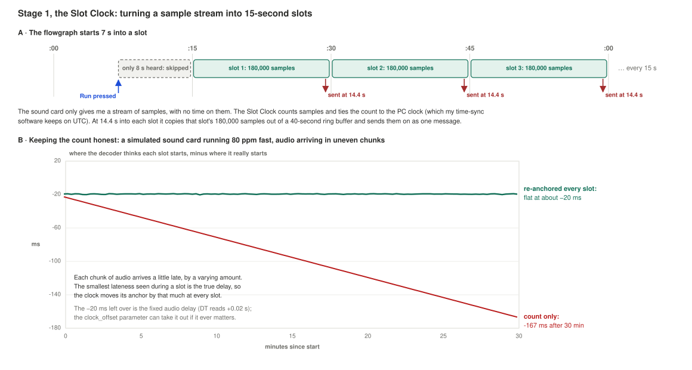

A sound card gives me a stream of samples with no time on them. FT8 needs to know where :00, :15, :30 and :45 fall *in that stream*. The Slot Clock is the stage that ties the two together.

It counts every sample it receives and remembers which PC time went with which sample count. My time-sync software keeps the PC clock on UTC, so from then on the Slot Clock can work out which sample is the start of each slot. It keeps the last 40 seconds in a ring buffer. At **14.4 s** into each slot, after even a late starter has finished, it copies that slot's 180,000 samples out and sends them on as one message.

Two details took some thought:

- **The first slot.** If I press Run at :07, the slot that started at :00 is missing its first seven seconds. The Slot Clock skips any slot with less than 13 s of audio, so I never get a half-decoded first table.
- **The sound card's own clock.** A sound card that runs 80 ppm fast (not unusual) delivers 80 extra samples per million. If I only counted samples, my idea of "slot start" would slide 1.2 ms per slot, and **167 ms after half an hour**, as the red line in the chart shows. So the Slot Clock watches how late each chunk of audio arrives. The *smallest* lateness during a slot is the true delay, so it moves its anchor by that much at every slot. The green line stays flat. The −20 ms left over is the fixed audio delay, which shows up as DT +0.02 s. That's harmless, and there's a `clock_offset` parameter if it ever matters.

For WSJT-X recordings there's a second mode (`pc_clock = False`) that simply counts slots from the first sample, because a saved WSJT-X file always starts at a slot boundary.

---

## Part 4: Stage 2, the Sync Search

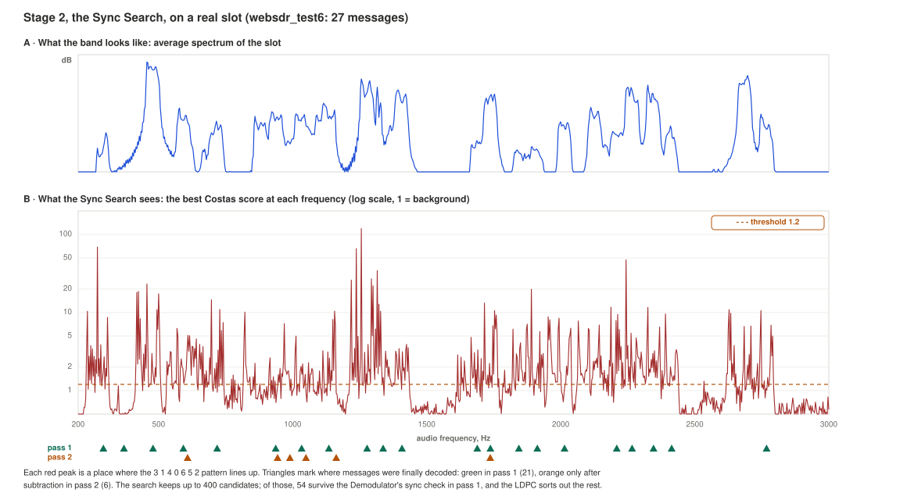

Now I have 15 seconds of audio and no idea where anything is. Stage 2's job is to find **candidates**: places in time and frequency where an FT8 signal might start.

1. **Spectrogram.** It cuts the slot into 1920-sample frames (one symbol long), moving 480 samples (a quarter symbol) at a time, and takes the power at every 3.125 Hz. The result is a picture of the slot: 372 time steps by about 900 frequencies between 200 and 3000 Hz.
2. **Costas score.** For every frequency and every start time from −2.5 to +2.5 s, it asks: "if an FT8 signal started *here*, how much stronger are the 21 Costas tones than the other tones next to them?" Noise scores about 1. A real signal scores much higher.
3. **Background.** It divides every score by the typical score across the band, so "1" means "background" whatever the band conditions are.
4. **Candidates.** Everything above 1.2 is a candidate, up to 400 per pass. Near-duplicates (within 4 Hz and 40 ms) are merged.

The chart above is a real slot with 27 messages in it. Every red spike is a place where the 3-1-4-0-6-5-2 pattern lines up. Some reach 100 times the background. And look at the triangles under the chart: some messages (orange) were only found *after* the loud ones around them were removed. Part 8 explains how.

The threshold is low on purpose. False candidates are cheap: stage 3 throws most of them out, and the LDPC in stage 4 rejects the rest. Missing a real one isn't cheap.

---

## Part 5: Stage 3, the Demodulator

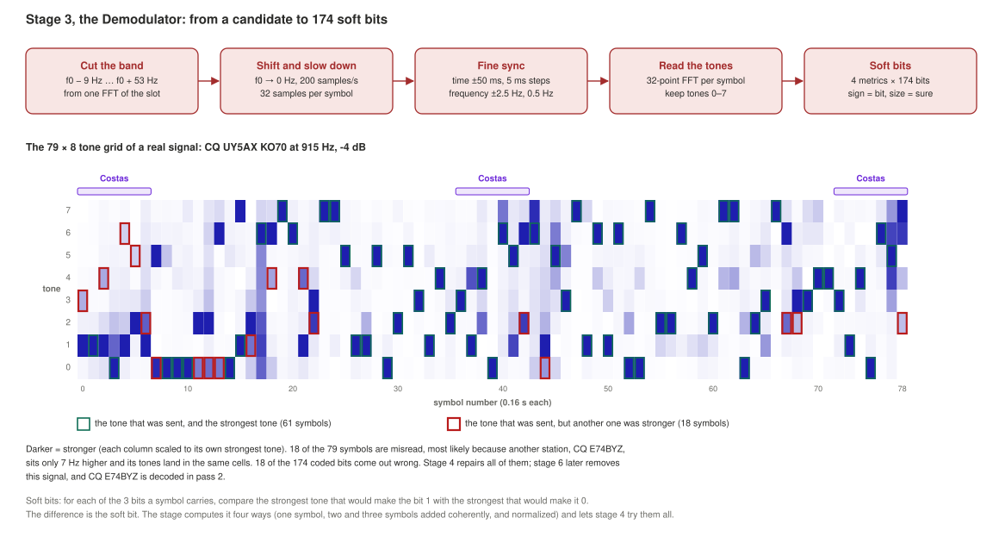

For each candidate, stage 3 zooms in.

1. **Cut out the signal's band.** One big FFT of the whole slot is computed once. For each candidate, the stage takes just the 62.5 Hz around it (from 9 Hz below the lowest tone to 9 Hz above the highest).
2. **Shift and slow down.** It moves that band to 0 Hz and turns it back into a time signal at only 200 samples per second: 32 samples per symbol. One small inverse FFT per candidate.
3. **Fine sync.** It slides the expected Costas pattern ±50 ms in 5 ms steps, then ±2.5 Hz in 0.5 Hz steps, and keeps the best fit. Then it re-cuts the band at the corrected frequency and checks the timing once more.
4. **Read the tones.** A 32-point FFT per symbol gives the strength of each of the 8 tones, in each of the 79 symbols: the **tone grid**.
5. **Quick sanity check.** If 6 or fewer of the 21 Costas symbols show the right tone, it was noise; drop it.

The picture shows a real tone grid, from the same slot as Part 4. The green outlines are the tones that were sent. Mostly they're also the strongest tones, but **18 of the 79 symbols are wrong** (red). The likely reason: another station, CQ E74BYZ, is transmitting just 7 Hz higher, and its tones land in the same cells.

### Soft bits

The grid has to become bits, and here's where it gets clever. For each of the 3 bits a symbol carries, the stage compares two numbers: the strongest tone that would make that bit a 1, and the strongest tone that would make it a 0. The difference is a **soft bit**: its sign says which bit is likelier, its size says how sure. A symbol where one tone clearly dominates gives big, confident soft bits. A symbol where two tones are close gives small, "not sure" ones.

The stage actually computes soft bits four ways:

- one symbol at a time;
- two symbols together, added *coherently* (amplitude and phase), which pulls a little more out of weak signals;
- three symbols together, the same way;
- one symbol at a time, scaled per bit.

It hands all four to stage 4, which tries each. WSJT-X does the same; I copied the idea.

---

## Part 6: Stage 4, LDPC + CRC

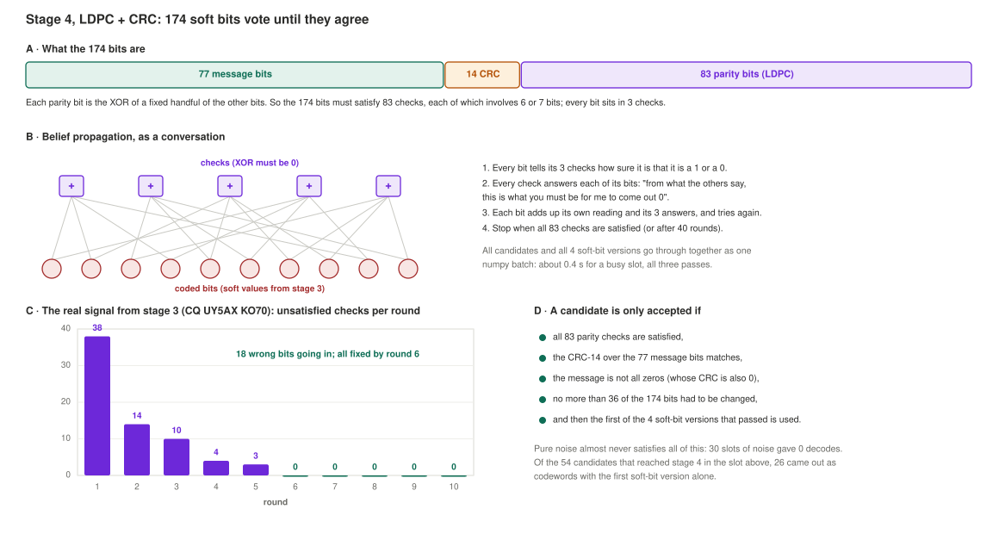

The 83 parity bits mean the 174 coded bits must satisfy **83 checks**. Each check says "these 6 or 7 bits must XOR to zero", and every bit takes part in 3 checks. That's an **LDPC code** (low-density parity check: each check only involves a few bits).

Stage 4 decodes it with **belief propagation**, which I think of as a conversation:

1. Every bit tells its three checks how sure it is (its soft bit).
2. Every check answers each of its bits: "given what the others told me, this is what you'd have to be for me to come out zero".
3. Every bit adds up its own reading and its three answers, and changes its mind if the answers are convincing enough.
4. Repeat until all 83 checks are happy, or give up after 40 rounds.

For CQ UY5AX, the signal with 18 bad symbols, **18 of the 174 coded bits** came in wrong. In the first round, 38 checks complained. Then 14, 10, 4, 3, and by round 6, none. Every wrong bit was repaired, and the message passed its CRC.

A candidate is only accepted if all of this holds:

- every parity check is satisfied;
- the CRC-14 matches;
- the message isn't all zeros (whose CRC happens to be zero too);
- no more than 36 bits had to be changed.

Pure noise essentially never gets through: 30 slots of noise gave zero decodes.

All candidates and all four soft-bit versions go through the decoder together, as one numpy batch. For a busy slot that's about 0.4 s, all three passes included.

---

## Part 7: Stage 5, Unpack + Report

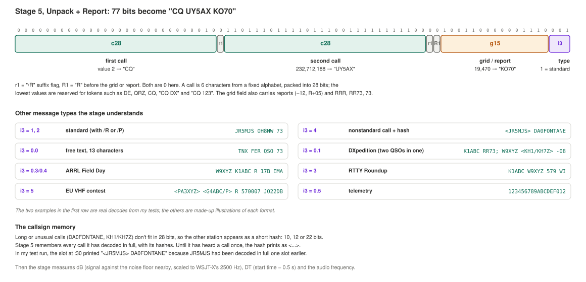

The 77 message bits are tightly packed. For the most common type (the last 3 bits say "1 = standard"):

- **28 bits** for the first callsign (or a token: the lowest values mean DE, QRZ, CQ, "CQ DX", "CQ 123" and so on);
- **1 bit** for a /R suffix;
- **28 bits** for the second callsign;
- **1 bit** for /R;
- **1 bit** for an "R" in front of the report;
- **15 bits** for a 4-character grid square, or a report (−12, R+05), or RRR, RR73, 73.

In the picture, value 2 in the first field is "CQ", 232,712,188 is "UY5AX", and 19,470 is "KO70". Stage 5 also reads the other types: free text, nonstandard calls, DXpedition, Field Day, RTTY Roundup, EU VHF contest and telemetry.

### The callsign memory

Some calls don't fit in 28 bits (DA0FONTANE, or anything with a prefix like KH1/). Messages with such a call carry the *other* station as a short **hash**: 10, 12 or 22 bits computed from the callsign. To print it, the receiver has to have heard that station's full call before. So stage 5 remembers every call it decodes, with its hashes. In my test run, slot :15 decoded "CQ JR5MJS PM74", and slot :30 could then print "**<JR5MJS> DA0FONTANE**" instead of "<...> DA0FONTANE".

### dB, DT, Freq

- **dB**: the signal's power against the noise floor around it (measured across ±300 Hz, from the spectrogram), scaled to the 2500 Hz reference WSJT-X uses.
- **DT**: when the transmission started, minus the nominal 0.5 s.
- **Freq**: the audio frequency of the lowest tone.

### Another pass, or done?

Stage 5 also decides what happens next. If this pass found something new and more passes are allowed (`passes = 3` by default), it sends the new decodes to stage 6. Otherwise the slot is finished: it prints the table in the console, adds the same rows to the QT table next to the waterfall (CQ rows in green, like WSJT-X), and puts one message per decode on its `decodes` port, for whatever I connect there later.

---

## Part 8: Stage 6, Subtract

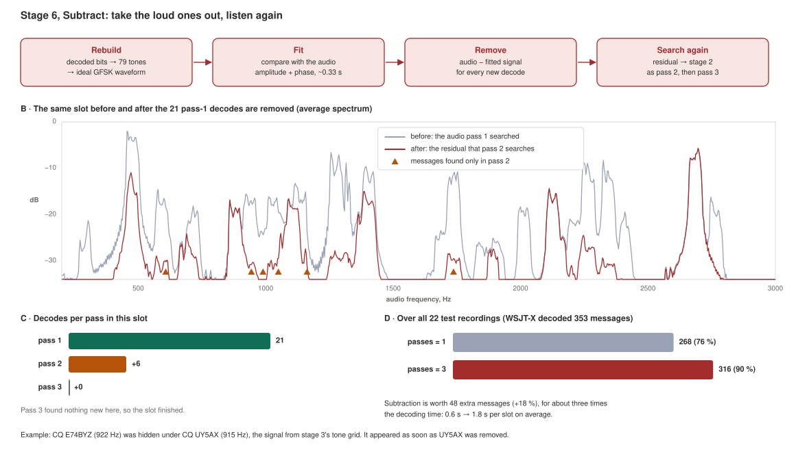

Here's the part that makes "decode *all* the QSOs" possible. When a strong station sits on top of a weak one, the weak one's tones get lost in the strong one's. The tone grid in Part 5 showed exactly that: CQ UY5AX at 915 Hz, with CQ E74BYZ just 7 Hz above it.

Once stage 4 has decoded the strong station, though, I know *exactly* what it sent: every tone, every symbol. So stage 6:

1. **Rebuilds** an ideal copy of that transmission: 79 tones, GFSK-smoothed, at the measured frequency and start time;
2. **Fits** it to the audio. It works out how loud the station is and what its phase is, smoothed over about a third of a second, because HF signals fade and wobble;
3. **Subtracts** it;
4. does this for every new decode, then sends the leftover audio, the **residual**, back to stage 2 as pass 2.

The spectrum in the picture shows the slot before (grey) and after (red) the 21 pass-1 decodes were removed. Most peaks drop by 10 dB or more, and six new messages show up in pass 2, CQ E74BYZ among them. Pass 3 found nothing more in this slot, so the slot finished.

Over all 22 test recordings, subtraction raised the count from **268 to 316** messages. Decoding takes about three times as long (0.6 s → 1.8 s per slot), which is still nothing next to a 15-second slot.

In GRC, the loop is just a message arrow from stage 6 back to stage 2. Message connections can form loops; sample streams can't. GNU Radio doesn't mind at all.

---

## Part 9: what do six stages cost?

This was the question I had before I started. Every arrow between stages is a message: a PMT dictionary carrying the slot's number, label and pass, plus whatever that stage produced (audio, candidate lists, soft bits, codewords). Passing 180,000 audio samples from block to block isn't free.

To find out how much it costs, I decoded all 22 recordings twice with the same decoding functions: once calling them back to back with no messages at all, and once through the six stages, passing real PMT messages between them as the flowgraph does:

| | Same code, no messages | Six stages, with messages |
|---|---|---|
| Messages decoded | 316 + 16 | **316 + 16, identical** |
| Time per slot (Python alone) | 1.69 s | 1.78 s (+5 %) |
| Time per slot (inside GNU Radio, displays running) | – | 1.6–2.0 s |

Each audio hop costs about 15 ms, once I learned how to make the conversion fast (war story 5). A bonus I hadn't planned: GNU Radio gives every block's message handler its own thread, so stages of consecutive slots can overlap. And when I want to look inside, I connect a Message Debug block to any arrow. That's what "transparent" means to me.

---

## Part 10: war stories

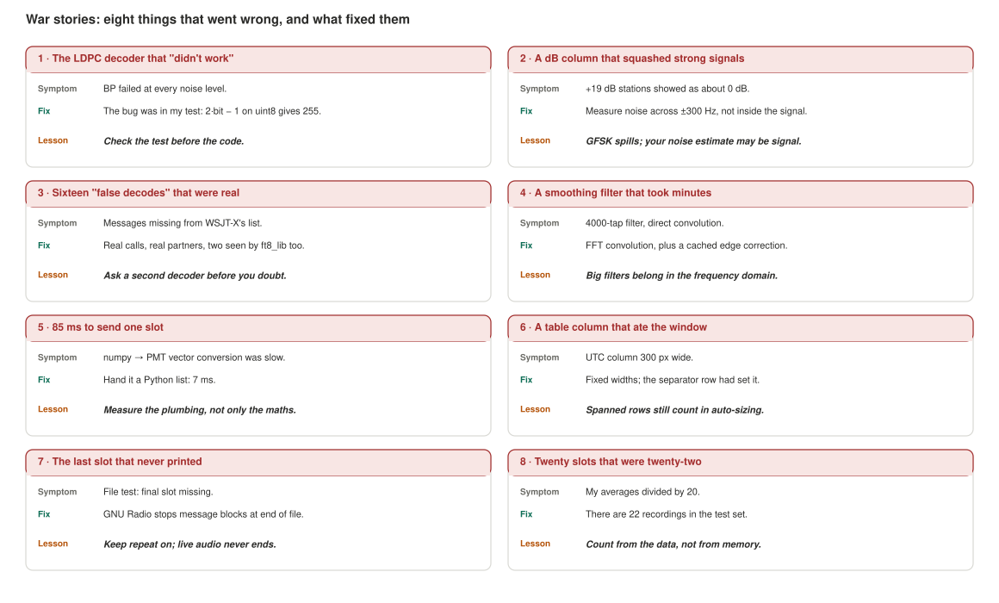

### 1. The LDPC decoder that "didn't work"

I wrote the belief-propagation decoder, fed it random codewords plus noise, and it failed. At every noise level. Every single time.

The decoder was fine. My *test* turned each bit into ±1 with `2·bit − 1`, and the bits were stored as `uint8`. In unsigned 8-bit arithmetic, 2·0 − 1 isn't −1, it's **255**. Half my "clean" test signal was garbage. One `.astype(float)` later, the decoder decoded. Lesson: **when something fails completely, check the test before the code.**

### 2. A dB column that squashed strong signals

My first SNR estimate measured the noise inside the signal itself, in the tones that weren't being sent. It looked sensible, and it was off by up to ±6 dB compared with WSJT-X, worst on strong stations: a +19 dB signal came out at about 0 dB.

The reason: GFSK smooths each tone change, so a little of every strong signal spills into the neighbouring tones, and my "noise" was partly signal. Measuring the noise floor across ±300 Hz from the spectrogram brought the spread down to about ±3 dB, with no average offset. Lesson: **a noise estimate taken next to the signal may be signal.**

### 3. Sixteen "false decodes" that were real

My first full comparison listed messages that weren't in WSJT-X's list for that slot. False decodes, surely? I looked at them. Real callsigns, real grid squares, QSO partners that show up in neighbouring slots, and two of them were also decoded by ft8_lib. WSJT-X's saved lists simply don't contain everything that was on the band. Lesson: **before you doubt a result, ask a second decoder.**

### 4. A smoothing filter that took minutes

Subtraction smooths the amplitude and phase fit with a 4000-sample filter. My first version used plain convolution: 4000 multiplications per sample, about 150,000 samples, for every decoded station. The comparison run on 22 recordings didn't get through the second recording in two minutes.

Doing the same filtering through FFTs made it a matter of milliseconds. Later I noticed the edge correction (dividing by the filter's coverage near the ends) is the same for every station, and cached it: subtraction went from 0.72 to 0.46 s per slot. Lesson: **big filters belong in the frequency domain.**

### 5. 85 milliseconds to send one slot

When I wired the stages together, my first measurement of a single message was alarming. Turning 180,000 samples from numpy into a PMT vector took **85 ms**. The general-purpose `pmt.to_pmt` took 46 ms. Handing the same samples over as a plain Python list took **7 ms**. Reading them back takes about 8 ms. With roughly three audio hops per pass, that's the difference between "costs nothing" and "costs half a second". Lesson: **measure the plumbing, not only the maths.**

### 6. A table column that ate the window

My first QT table had a UTC column about 300 pixels wide, squeezing the messages into a sliver. I'd told the first four columns to size themselves to their contents, and the grey separator row between slots ("---- slot 000015, 14 decodes …") sits in column 0, spanned across the whole row. Qt still sized column 0 to fit it. Fixed widths solved it. Lesson: **spanned rows still count when columns size themselves.**

### 7. The last slot that never printed

Testing with a WAV file and Wav File Source's repeat switched off, the last slot never appeared. When a file source runs out, GNU Radio decides the flowgraph is finished and stops the message-only blocks too, in the middle of decoding that slot. With repeat on (the default in my flowgraph) it's fine, and a live sound card never runs out. Lesson: **message blocks live and die with the stream that feeds them.**

### 8. Twenty slots that were twenty-two

While drawing the results chart for this document, I counted the bars: 22, not 20. My comparison script had a hand-typed "/ 20" for its averages, and the earlier write-up repeated "20 slots". The decode counts were right all along; the per-slot times were about 10 % too high, and the number of recordings was simply wrong. Both are corrected now. Lesson: **count from the data, not from memory.**

---

## Results

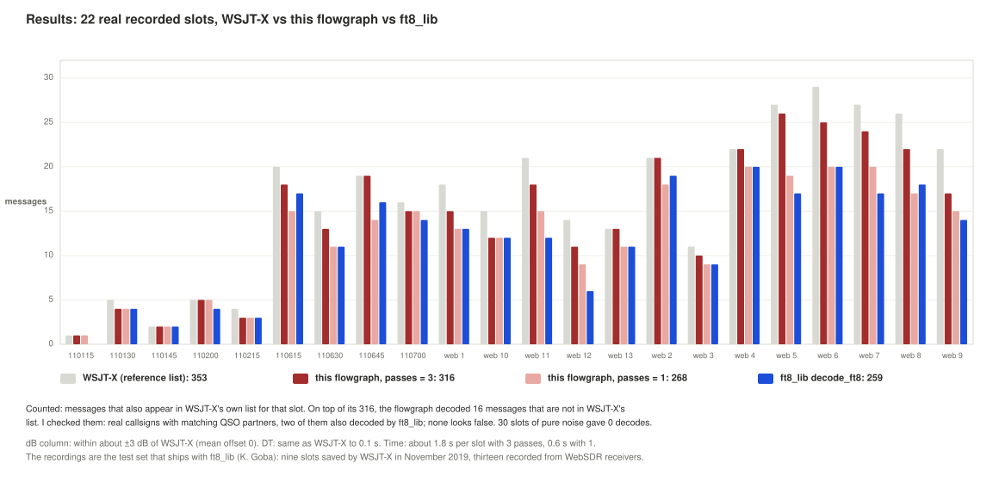

On 22 real slots (ft8_lib's test set: nine slots saved by WSJT-X in November 2019, thirteen recorded from WebSDR receivers), compared with the messages WSJT-X decoded from the same audio:

| What | Result |
|---|---|
| **WSJT-X's list** | 353 messages |
| **This flowgraph, passes = 3** | **316 of them (90 %)**, plus 16 valid messages that aren't in WSJT-X's list |
| This flowgraph, passes = 1 | 268 (76 %) |
| ft8_lib's decoder, for comparison | 259 (73 %) |
| **False decodes** | 0 in 30 slots of pure noise |
| **dB** | within about ±3 dB of WSJT-X, mean offset 0 |
| **DT** | same as WSJT-X to 0.1 s |
| **Time** | about 1.8 s per slot with 3 passes (0.6 s with 1); 1.6–2.0 s inside GNU Radio with the displays running |
| **Slot clock** | simulated 80 ppm sound card with uneven audio delivery: slot timing stays put (−20 ms fixed delay) instead of drifting 167 ms in 30 minutes |
| **Cost of the six stages** | about 15 ms per audio hop between stages; +5 % time against the same code run without messages |

Where WSJT-X still wins: it has a few more tricks for the weakest signals. It can guess part of a message from what it expects (a-priori decoding), and it falls back to a heavier decoder (OSD) when belief propagation gives up. Those are worth its last 1 to 3 dB. For a flowgraph built from numpy and stock blocks, 90 % of WSJT-X makes me very happy.

---

## How to run it

1. Connect the radio's speaker (or line/data output) to the laptop's Line In. Set the radio to USB, the filter to about 3 kHz, and turn **off** noise reduction, notch and narrow filters: they wreck FT8. Turn off Windows' "audio enhancements" and mic boost.
2. Make sure your time-sync software has the PC clock on UTC.
3. Open **ft8_rx.grc** in GRC (GNU Radio 3.10, radioconda).
4. Check the variables:
   - `f_min`, `f_max`: the audio range to search (200–3000 Hz).
   - `passes`: 3 for the most decodes, 1 for the fastest.
   - `pc_clock`: True for the sound card.
5. Leave the Audio Source device name blank for the default recording device, or type yours in.
6. Run. Keep the audio level well below clipping: on the spectrum, the noise floor should sit comfortably above the bottom and no peak should hit the top. The first table appears about 17 seconds after the first full slot.

The console looks like this (this one is from a test recording):

```
UTC     dB   DT  Freq  Message
------ slot 000000 (file time) : 18 decodes (2.0 s, 3 passes) ------
000000 -15  1.0   297 ~  <...> ON7EE JO10
000000   2  1.0   431 ~  VK4BLE OH8JK R-17
000000 -12  0.9   539 ~  RK6AH JH1AJT -05
000000 -23  0.8   594 ~  CQ DG0OFT JO50
000000 -10  1.8   700 ~  RV6K RU3XL -13
```

Live, the separator line shows the real UTC date and time instead of "file time".

On the GUI:

- **Spectrum** and **Waterfall**, 0–4 kHz. Use the middle-click menu's autoscale to fit your audio level.
- **Decode table**, right of the waterfall: UTC, dB, DT, Freq, Message, CQ rows in green, a grey line per slot, and a Clear button.

A few notes:

- **To test with WSJT-X recordings** (Save → Save all in WSJT-X): disable Audio Source and the Low Pass Filter, enable Wav File Source and Throttle, point `wav_file` at the .wav, and set `pc_clock = False`. Keep repeat on (war story 7).
- **DT consistently off by the same amount** (say +0.3 s on every station): check the time sync first. If the clock is right, set `clock_offset` on the Slot Clock.
- **No decodes at all**: look at the waterfall. If you can see the FT8 signals as stripes, check the PC clock. If you can't, check the audio level and the radio's filters.
- **Decode times near 15 s** on the separator lines: the laptop can't keep up. Set `passes = 1`.
- **To look inside**: connect a Message Debug block to any arrow between stages. The audio-carrying ones are big, so print only the field names.

---

## TODO

There's a lot of room for improvement!

- **Go on air** with my own radio, and compare against WSJT-X running on the same audio at the same time.
- **The sync-score display**: a vector output from stage 2 showing its Costas score across the band under the spectrum, so I can watch where it finds candidates each slot.
- **Early decoding**: WSJT-X makes an early pass before the slot is over, so strong stations show up sooner.
- **A-priori decoding** for "CQ" messages: the cheapest of WSJT-X's extra tricks.
- **Better subtraction**: the fit leaves strong stations about 10–15 dB down, not gone. A tighter fit might find a few more weak ones underneath.
- **A UDP output** in WSJT-X's format, so logging programs and GridTracker could listen to my flowgraph.
- **FT4**, which uses the same building blocks at a faster rate.

---

## Acknowledgements

- The **GNU Radio** project, and **radioconda** for making it painless on Windows.
- **Joe Taylor K1JT, Steve Franke K9AN and the WSJT-X team** for FT8 itself, and for publishing the protocol in enough detail to reimplement it.
- **Karlis Goba** for **ft8_lib** (MIT licence): its tables, its message code, and especially its test recordings with WSJT-X's own decodes, which made it possible to measure every change I made.
- The FT8 operators heard in those recordings, for unknowingly being my test signals, and especially CQ UY5AX and CQ E74BYZ for overlapping each other so instructively.
