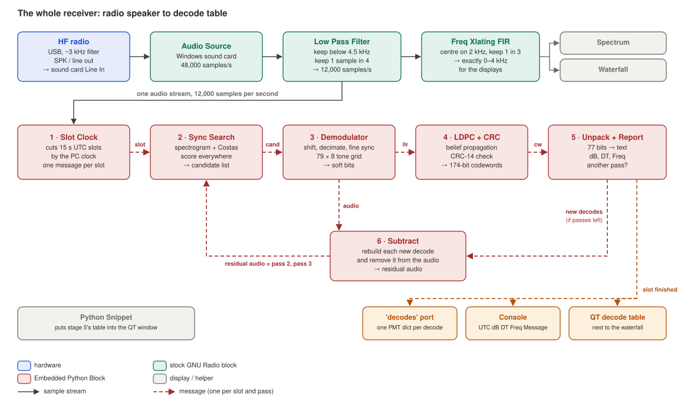

# FT8 Multi-Signal Receiver (`ft8_rx.grc`)

A sound-card FT8 decoder for GNU Radio 3.10 on Windows (radioconda). It uses stock blocks for capture, filtering and display, and six Embedded Python Blocks (numpy only, no OOT modules, no DLLs) for decoding. The decoder is split into stages, one job each, connected by messages. Every 15 s it prints all decoded messages as a WSJT-X style table (`UTC dB DT Freq Message`), both in the GRC console and in the QT window, next to a spectrum and a waterfall.

The plain-English story of this flowgraph is in `ft8_rx_plain_english.md`.

## Flowgraph



```
                                     ┌──────────────────────── residual audio (passes 2, 3) ─────────────────────┐
                                     ▼                                                                            │
 Audio Source ─▶ LPF ÷4 ─▶ 1 Slot Clock ─slot─▶ 2 Sync Search ─cand─▶ 3 Demodulator ─llr─▶ 4 LDPC + CRC ─cw─▶ 5 Unpack + Report ─▶ console / QT table / 'decodes'
   48 kHz          │ 12 kHz                                                 │ audio                              │ new decodes
                   │                                                        └──────────────▶ 6 Subtract ◀────────┘
                   └─▶ Freq Xlating FIR (2 kHz, ÷3) ─▶ Spectrum + Waterfall (0–4 kHz)

Python Snippet: puts stage 5's table into the QT window
Disabled test path: Wav File Source → Throttle (for WSJT-X .wav files)
```

| Operation | Block | Why |
|---|---|---|
| Sound-card capture | Audio Source (48 kHz) | stock |
| Anti-alias + decimate to 12 kS/s | Low Pass Filter (4.5 kHz cutoff, 1 kHz transition, ÷4) | stock |
| Display band 0–4 kHz | Freq Xlating FIR (centre 2 kHz, ÷3) → QT Frequency Sink + QT Waterfall Sink | stock; the shift centres the plots on 2 kHz so the axis reads 0–4000 Hz audio |
| Slot timing | EPB 1 `FT8 Slot Clock` | no stock block ties a sample stream to UTC slots |
| Costas search, demodulation, soft bits | EPB 2 `FT8 Sync Search`, EPB 3 `FT8 Demodulator` | no stock equivalent; a stock FFT can't make the overlapped, slot-aligned spectrogram, and the later steps need the raw audio anyway |
| LDPC(174,91) + CRC-14 | EPB 4 `FT8 LDPC + CRC` | gr-fec's LDPC decoder works on streams; here the soft bits arrive as one message per pass with a variable number of candidates, four metrics each, and "first metric that passes the CRC" logic |
| Message unpack, SNR/DT/Freq, table | EPB 5 `FT8 Unpack + Report` | no stock equivalent |
| Signal subtraction | EPB 6 `FT8 Subtract` | no stock equivalent |
| Table in the QT window | Python Snippet (Main – After Init) | GRC has no stock text table widget |

## The six stages

| Stage | Input → output | What it does |
|---|---|---|
| 1 Slot Clock | 12 kHz stream → `slot` | Cuts the audio into 15 s UTC slots using the PC clock and follows sound-card drift. File mode counts slots from the first sample. |
| 2 Sync Search | `slot` → `cand` | Spectrogram + Costas 7×7 score over frequency and lag → candidate list. Normalizes the audio on pass 0. |
| 3 Demodulator | `cand` → `llr`, `audio` | Shift to 0 Hz, decimate to 200 S/s, fine sync, 79×8 tone amplitudes, 4 soft-bit metrics. Drops candidates with ≤ 6 of 21 sync tones correct. |
| 4 LDPC + CRC | `llr` → `cw` | Batch BP decoding, CRC-14, hard-error limit. |
| 5 Unpack + Report | `cw` → `new`, `decodes` | Removes duplicates, unpacks, measures SNR/DT/Freq. Decides whether another pass runs (`passes`). Prints the table and feeds the QT table. |
| 6 Subtract | `audio` + `new` → `slot` | Rebuilds each new decode as GFSK, fits it, subtracts it, and sends the residual to stage 2 as the next pass. |

### 1 · Slot Clock

- Keeps a 40 s ring buffer of the 12 kHz audio and ties the sample count to the PC clock (`time.time()`, kept on UTC by time-sync software).
- Re-anchors every slot: the smallest delivery delay seen during the slot is taken as the true delay, so sound-card clock drift doesn't accumulate. Tested in simulation with an 80 ppm error and random delivery jitter: slot timing stays at a fixed −20 ms (the audio delay), instead of drifting 167 ms in 30 minutes. A jump of more than 1 s (lost samples, clock step) forces a fresh anchor.
- At `decode_at` = 14.4 s into each slot it sends the slot's 180 000 samples as one message. A slot with less than 13 s of audio (the one the flowgraph joined late) is skipped.
- `pc_clock = False`: slots are counted from the first sample (WSJT-X .wav files start on a slot boundary).
- `clock_offset`: seconds added to the PC clock, for a fixed audio delay. Usually 0.

### 2 · Sync Search

- Power spectrogram: 1920-sample frames (one symbol) every 480 samples (40 ms), zero-padded to 3840 points → 3.125 Hz bins; 372 time steps × ~900 bins over `f_min`…`f_max` (200–3000 Hz).
- Costas score at every bin and every lag from −2.48 s to +2.48 s: power in the 21 Costas tones divided by the average of the other tones in the 7-tone span. All three Costas blocks are scored, and also the last two alone, for signals that started early.
- Best score per frequency over a narrow lag window (±0.4 s) and over the full window, each normalized by the 40th percentile across frequency (1 = background).
- Candidates: score ≥ `syncmin` (1.2), at most `maxcand` (400); duplicates within 4 Hz and 40 ms merged.
- Also outputs the 40th-percentile noise spectrum per bin (pass 0), which stage 5 uses for the dB column.

### 3 · Demodulator

- One 192 000-point FFT of the slot (0.0625 Hz bins). Per candidate: the band from f0 − 9.4 Hz to f0 + 53.1 Hz with a 6 Hz cosine taper, shifted to 0 Hz, and a 3200-point IFFT → 200 S/s, 32 samples per symbol.
- Fine sync on the Costas arrays: time ±50 ms (5 ms steps), then frequency ±2.5 Hz (0.5 Hz steps); re-cut at the corrected frequency; time again ±20 ms.
- 32-point FFT per symbol → 79 × 8 complex tone amplitudes. Rejected if ≤ 6 of the 21 Costas symbols have the right strongest tone.
- Soft bits, four variants (as WSJT-X): 1-symbol, 2-symbol coherent and 3-symbol coherent max-log metrics, and the 1-symbol metric normalized per bit; each scaled to unit standard deviation × 2.83.

### 4 · LDPC + CRC

- Sum-product belief propagation on the (174,91) code, all candidates × 4 metrics in one numpy batch, up to `max_iter` (40) iterations with early stop.
- Accepted if: all 83 parity checks pass, CRC-14 matches, the payload isn't all zeros, and at most 36 hard-decision bits were changed. The first metric that passes is used.

### 5 · Unpack + Report

- Drops payloads already decoded in an earlier pass of the same slot, then unpacks: standard (/R, /P), nonstandard calls with hashes (`<CALL>` or `<...>`), free text, DXpedition, ARRL Field Day, RTTY Roundup, EU VHF and telemetry. The callsign hash table (10/12/22-bit) persists across slots.
- dB: mean power of the decoded tones against the noise floor (20th percentile of stage 2's noise spectrum over f − 300 … f + 350 Hz), scaled to a 2500 Hz reference, clamped at −24 dB. DT = start time − 0.5 s. Freq = tone 0.
- If this pass found something new and `passes` allows another, the new decodes (tones, frequency, start time) go to stage 6. Otherwise the slot is finished: console table, QT table (CQ rows green, a grey line per slot, Clear button) and one PMT dict per decode on `decodes` (`utc`, `snr`, `dt`, `freq`, `msg`).

### 6 · Subtract

- Caches each pass's audio from stage 3. For every new decode: rebuilds the 79-tone GFSK (BT = 2) waveform at its frequency and start time, estimates amplitude and phase with a 4000-sample (0.33 s) cos² smoothing filter (FFT convolution, cached edge correction), and subtracts it.
- Sends the residual to stage 2 as pass + 1.

### Messages

Every message is a PMT dict carrying `slot`, `label`, `pretty`, `pass` and `t0` plus that stage's arrays (`audio`, `f0`/`xdt`/`sync`, `base`, `f1`, `ib`, `llr`, `cs`, `cw`, `tones`, `tstart`). numpy arrays are converted via Python lists, which costs about 15 ms per 180 000-sample hop (`pmt.init_f32vector` straight from numpy took 85 ms). GNU Radio runs each block's message handler in its own thread, so stages of consecutive slots can overlap. To look inside, connect a Message Debug block to any arrow; the audio-carrying messages are large, so print only the field names.

## Measured on 22 real recorded slots

The ft8_lib test set: 9 slots saved by WSJT-X, 13 recorded from WebSDR receivers, each with WSJT-X's list of decoded messages.

| Decoder | Messages decoded |
|---|---|
| WSJT-X (reference list) | 353 |
| **ft8_rx, passes = 3** | **316 of those (90 %)**, plus 16 valid messages missing from the WSJT-X list (real calls with matching partners; two also decoded by ft8_lib) |
| ft8_rx, passes = 1 | 268 (76 %) |
| ft8_lib decode_ft8 | 259 (73 %) |

- False decodes in 30 slots of pure noise: 0.
- dB column vs WSJT-X: mean offset 0 dB, spread ±3 dB.
- DT matches WSJT-X to 0.1 s.
- Decode time: about 1.8 s per slot on average with passes = 3 (0.6 s with passes = 1), up to about 2.5 s for the busiest slots (one core, numpy). Inside GNU Radio with the QT sinks running: 1.6–2.9 s per slot.
- Not yet tested on air with a live radio.

## Use

**Live:**
1. Feed the radio's line/data/speaker output to Line In.
2. Set USB mode with a 3 kHz filter and the radio's NR, notch and narrow filters off. Turn off Windows "audio enhancements" and mic boost, and keep the level well below clipping.
3. Keep the PC clock on UTC with time-sync software.
4. Leave the Audio Source device name blank to use the default recording device, or enter the device name.
5. Run (F6). The first table appears about 17 s after the first full slot.

**Test with WSJT-X recordings:**
1. In WSJT-X, choose Save → Save all; the recordings are 12 kHz mono .wav files.
2. Disable Audio Source and Low Pass Filter, and enable Wav File Source and Throttle.
3. Set `wav_file`, and set `pc_clock = False` so slots are counted from the start of the file.
4. Keep Wav File Source `repeat = True` (the default). With repeat off, GNU Radio stops the message blocks when the file ends, and the last slot may not print.

**Variables:**
- `f_min` / `f_max`: search range in Hz (default 200–3000).
- `passes`: 1 is fastest; 3 gives the most decodes.
- `pc_clock`: True for a sound card, False for WSJT-X files.
- Slot Clock parameter `clock_offset`: a fixed offset in seconds added to the PC clock if DT is consistently off.

## Limits

- No a-priori decoding and no OSD fallback. These are what give WSJT-X its last 1–3 dB.
- No early decode: messages appear about 2 s after the slot ends.
- Only FT8; FT4 is not supported.
